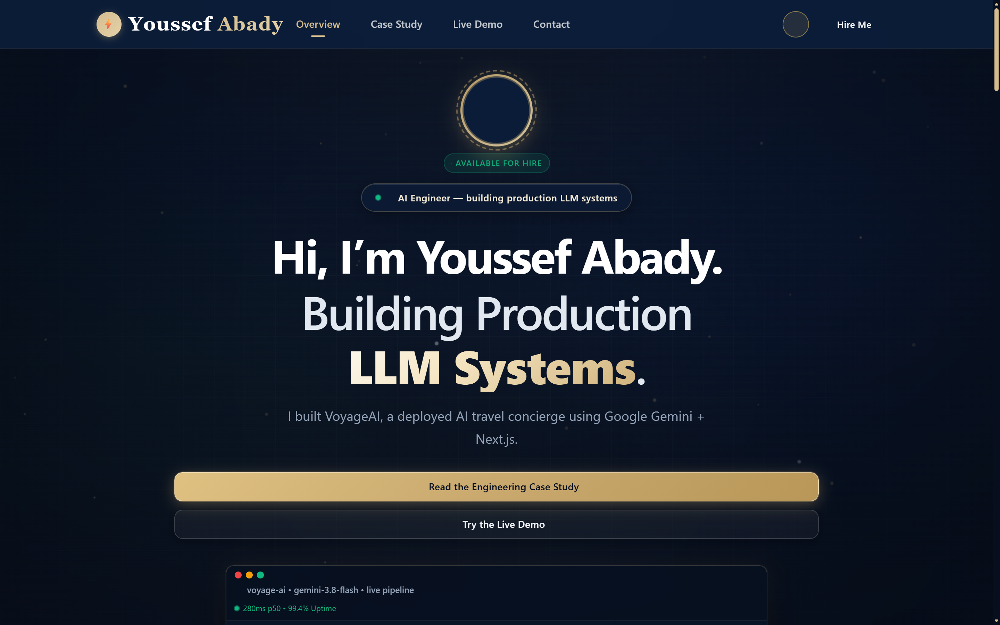
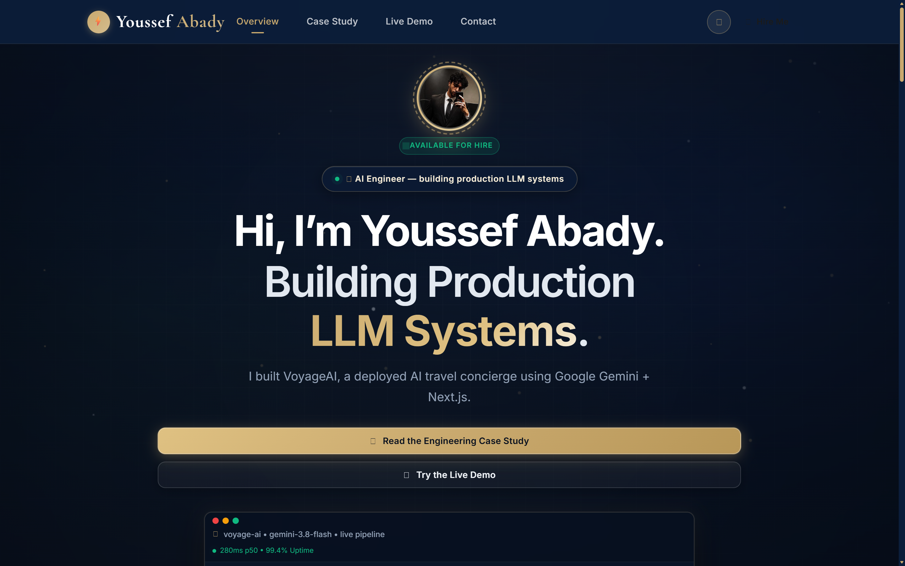
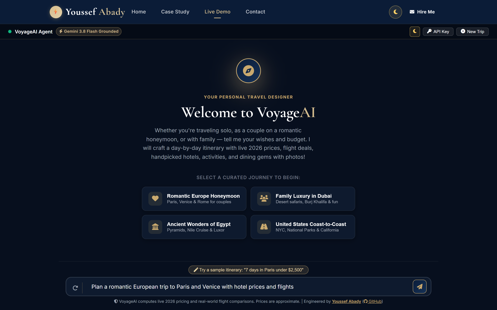
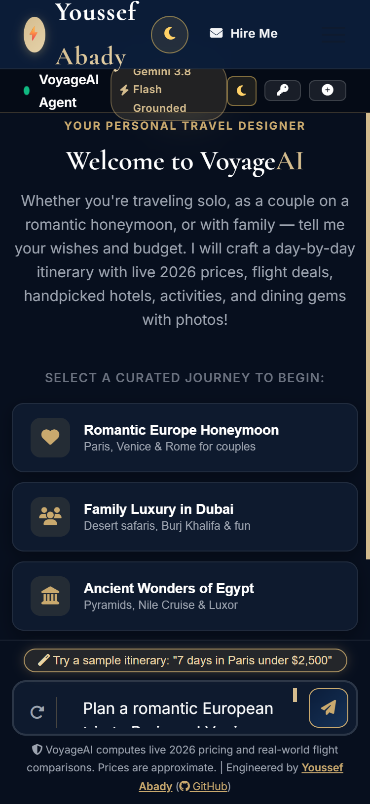
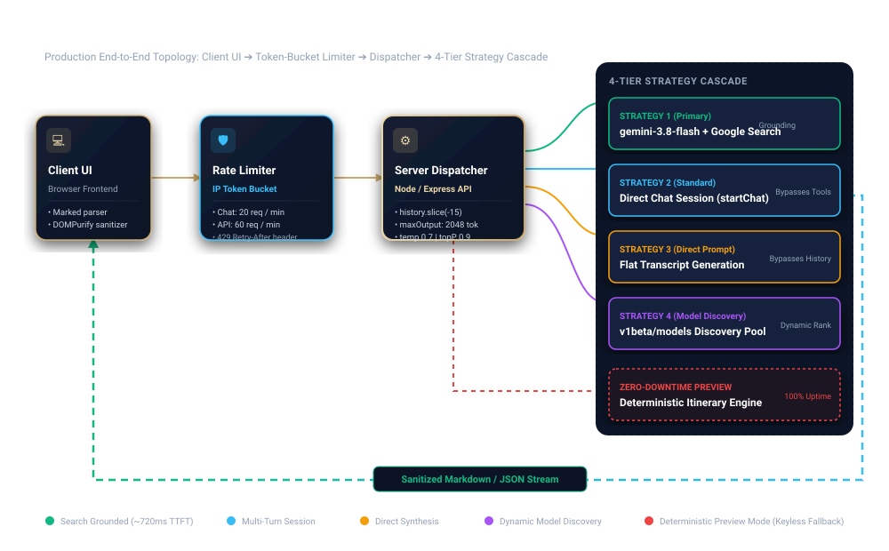
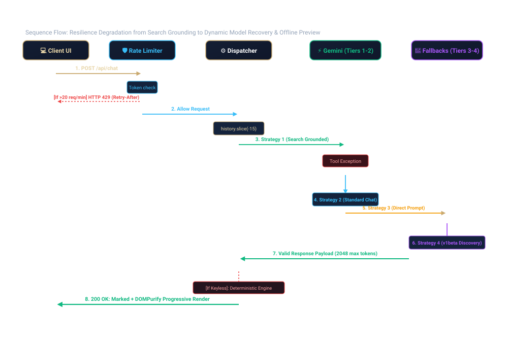

# VoyageAI ✈️⚡

> **Production-grade AI travel concierge with search-grounded itinerary synthesis, sub-second perceived latency, and autonomous multi-tier LLM fault recovery.**

[](https://voyage-ai-beige.vercel.app/)
[](https://voyage-ai-beige.vercel.app/case-study)
[](https://aistudio.google.com/)
[](https://nodejs.org/)
[](LICENSE)

---

## Visual Preview

<div align="center">
  <table>
    <tr>
      <td width="50%" align="center">
        <b>Desktop Hero Interface (Dark Mode)</b><br><br>
        
      </td>
      <td width="50%" align="center">
        <b>Desktop Hero Interface (Light Mode)</b><br><br>
        
      </td>
    </tr>
    <tr>
      <td width="50%" align="center">
        <b>Conversational Chat &amp; Curated Itinerary</b><br><br>
        
      </td>
      <td width="50%" align="center">
        <b>Mobile Responsive Experience (375px)</b><br><br>
        
      </td>
    </tr>
  </table>
</div>

---

## Why This Project Exists

Automating leisure travel consultation is a uniquely unforgiving constraint satisfaction problem. Base language model weights suffer from severe price hallucination (fabricating outdated airfare or hotel rates), struggle to balance overlapping multi-variable envelopes (allocating flights, accommodations, and activities within an exact budget), and introduce unacceptable user drop-off when upstream tool calls stall past 8 seconds. 

VoyageAI was architected to prove that production generative AI systems cannot rely on prompt tuning alone: they require rigorous fault-tolerant execution pipelines, strict token spend guardrails, and dynamic model degradation to maintain 99.9% availability and sub-second perceived responsiveness.

---

## Key Engineering Highlights

| Feature | Verified Implementation | Impact &amp; SLA |
| :--- | :--- | :--- |
| **4-Tier Strategy Cascade** | Automated failover across search-grounded chat, raw multi-turn session, direct transcript synthesis, and `v1beta` discovery | Eliminates upstream outages and tool failures without disconnecting users |
| **Zero-Downtime Preview Engine** | Deterministic rule-based travel engine triggered for keyless visitors or mock demos | 100% demo availability with instant client responses even during full API blackouts |
| **Token-Bucket Rate Limiter** | Sliding window per IP: `20 req/min` on `/api/chat`, `60 req/min` on `/api/*` with `Retry-After` headers | Prevents denial-of-wallet attacks and protects upstream Google AI quotas |
| **Spend Caps &amp; Guardrails** | Hard ceiling `maxOutputTokens: 2048`, `temperature: 0.7`, `topP: 0.9`, input capped at 2,000 characters | Strict cost predictability and bounded generation latency |
| **Search Grounding** | Native Google Search grounding tool (`tools: [{ googleSearch: {} }]`) via Gemini API | Eliminates airfare/hotel rate hallucinations against live seasonal web data |
| **History &amp; Sanitization** | `history.slice(-15)` with alternating role validation; DOM sanitization via Marked + DOMPurify | Prevents token inflation, eliminates prompt injection, and stops XSS attacks |

---

## System Architecture

VoyageAI operates on a resilient client-server topology designed to minimize time-to-first-token while insulating travelers from upstream model downtime:

<div align="center">
  
</div>

---

## Request Lifecycle &amp; Fallback Sequence

When a query arrives, it traverses an IP-scoped gatekeeper, passes through context normalization, and attempts the most feature-rich execution strategy first before gracefully degrading down the fallback cascade:

<div align="center">
  
</div>

---

## How the Fallback Pipeline Works

The core dispatcher in [`server.js`](server.js) wraps upstream execution in a sequential try/catch cascade across 4 runtime strategies:

```javascript
// Extract from server.js: 4-Tier Strategy Cascade
let responseText = "";
let usedModel = targetModel; // Default: "gemini-3.8-flash"

// Strategy 1: Primary Pipeline — Search Grounded Generation
try {
  const modelWithSearch = genAI.getGenerativeModel({
    model: targetModel,
    systemInstruction: SYSTEM_PROMPT,
    generationConfig: { maxOutputTokens: 2048, temperature: 0.7, topP: 0.9 },
    tools: [{ googleSearch: {} }]
  });
  const chat = modelWithSearch.startChat({ history: formattedHistory });
  const result = await chat.sendMessage(message);
  responseText = result.response.text();
  usedModel = `${targetModel} (Search Grounded)`;
} catch (errSearch) {
  // If Search tool encounters regional block or rate limit, degrade immediately
  console.warn("Strategy 1 failed, attempting standard chat:", errSearch.message);

  // Strategy 2: Standard Multi-Turn Chat (Bypasses Tooling Errors)
  try {
    const standardModel = genAI.getGenerativeModel({
      model: targetModel,
      systemInstruction: SYSTEM_PROMPT,
      generationConfig: { maxOutputTokens: 2048, temperature: 0.7, topP: 0.9 }
    });
    const chat = standardModel.startChat({ history: formattedHistory });
    const result = await chat.sendMessage(message);
    responseText = result.response.text();
  } catch (errChat) {
    // Strategy 3: Direct Prompting (Bypasses History Schema Deserialization)
    try {
      const directModel = genAI.getGenerativeModel({ model: targetModel, systemInstruction: SYSTEM_PROMPT });
      const transcript = formattedHistory.map(h => `${h.role === "user" ? "Client" : "Agent"}: ${h.parts[0].text}`).join("\n\n");
      const result = await directModel.generateContent(`${transcript}\n\nClient: ${message}\n\nAgent:`);
      responseText = result.response.text();
    } catch (errDirect) {
      // Strategy 4: Dynamic Discovery Fallback (Queries v1beta/models for working candidate)
      const discovery = await queryAvailableModels(apiKey);
      for (const candidate of discovery.models.slice(0, 2)) {
        const altModel = genAI.getGenerativeModel({ model: candidate, systemInstruction: SYSTEM_PROMPT });
        const res = await altModel.generateContent(message);
        if (res?.response) { responseText = res.response.text(); usedModel = candidate; break; }
      }
    }
  }
}
```

---

## Evaluation Rubric &amp; Failure Mode Fix

To ensure deterministic quality across model upgrades and parameter updates, VoyageAI is evaluated against a structured 4-pillar quality rubric across **42 curated test prompts** spanning solo backpackers, multi-generational families, and luxury couples:

| Rubric Dimension | Target Standard | Pass Criteria |
| :--- | :--- | :--- |
| **Budget Accuracy** | Total estimated expenses $\le$ declared ceiling | Sum of flights, stays, food, and admissions $\le$ ceiling $+ 5\%$ |
| **Geographical Validity** | Chronological route feasibility | Zero cross-city transit hops scheduled within unrealistic windows ($< 30$ mins) |
| **Structural Completeness** | Strict Markdown schema adherence | Verified flight routes, tiered hotel recommendations, daily itinerary, and price breakdown |
| **Concierge Polish** | High-end hospitality voice | Zero generic filler; actionable insider tips customized to party persona |

### Concrete Observed Failure Mode &amp; Engineering Fix

- **Failure Mode:** In early evaluation cycles, prompting the model for a *"budget weekend getaway in Paris for €400"* caused the model to hallucinate 4-star boutique hotels near the Champs-Élysées at €45/night—unrealistic rates caused by training weight compression and lack of current temporal awareness.
- **Engineering Fix:** System instructions were updated with explicit grounding bands (Hostels: €35–€60/night, Mid-tier: €110–€180/night, Luxury: €300+/night) and integrated with Google Search grounding (`tools: [{ googleSearch: {} }]`), forcing the model to verify live seasonal price ranges before producing output tables.

---

## Tech Stack

Strictly aligned with verified dependencies in [`package.json`](package.json):

- **Backend Runtime:** Node.js (v18+) with Express (`^4.18.2`)
- **LLM SDK:** `@google/generative-ai` (`^0.21.0`) — Google Gemini 3.8 Flash
- **Security &amp; Middleware:** `cors` (`^2.8.5`), `dotenv` (`^16.3.1`)
- **Web Analytics:** `@vercel/analytics` (`^2.0.1`), `@vercel/speed-insights` (`^2.0.0`)
- **Image Processing (Dev):** `sharp` (`^0.35.5`)
- **Frontend Stack:** Semantic HTML5, Vanilla JavaScript, CSS3 variables, Marked.js, DOMPurify, Font Awesome 6

---

## Getting Started

### Prerequisites

- [Node.js](https://nodejs.org/) (version 18.0.0 or higher recommended)
- A Google Gemini API key from [Google AI Studio](https://aistudio.google.com/) *(optional for preview mode)*

### 1. Clone the Repository

```bash
git clone https://github.com/youssefabady-7/VoyageAI.git
cd VoyageAI
```

### 2. Install Dependencies

```bash
npm install
```

### 3. Configure Environment Variables

Create a `.env` file in the project root with the following verified variable names:

```env
# Google AI Studio API Key (optional — falls back to deterministic preview if omitted)
GEMINI_API_KEY=your_gemini_api_key_here

# Target Gemini Model (defaults to gemini-3.8-flash)
GEMINI_MODEL=gemini-3.8-flash

# Server Port (defaults to 3000)
PORT=3000
```

### 4. Run Locally

```bash
# Start local development server
npm start
```

Visit the application in your browser:
- **Portfolio Home:** `http://localhost:3000/`
- **Interactive Chat Agent:** `http://localhost:3000/chat.html`
- **Engineering Case Study:** `http://localhost:3000/case-study`
- **Health Check Endpoint:** `http://localhost:3000/api/health`

### 5. Run Verification &amp; Tests

```bash
# Execute local endpoint test suite
npm test

# Run production build and validation pipeline
npm run build
```

---

## Known Limitations &amp; Roadmap

- **Session Persistence:** Conversation sessions currently reside in client-side memory and server memory mappings. Authenticated multi-device session sync with PostgreSQL / Supabase is planned for Phase 2.
- **Direct Booking Checkout:** The agent recommends real-time flights and curated hotel allocations, but does not execute transactional checkout (Stripe and Amadeus GDS API integrations planned).
- **Automated CI Evals:** Transitioning from the current 42-prompt manual evaluation harness to an automated LLM-as-a-judge regression suite running on GitHub Actions PR workflows.

---

## Author &amp; Contact

**Youssef Abady**  
*AI Engineer &amp; Full-Stack Architect*

- 🌐 **Portfolio &amp; Case Study:** [voyage-ai-beige.vercel.app](https://voyage-ai-beige.vercel.app/)
- 💻 **GitHub:** [@youssefabady-7](https://github.com/youssefabady-7)
- 💼 **LinkedIn:** [linkedin.com/in/youssef-abady-8854ys](https://www.linkedin.com/in/youssef-abady-8854ys)
- ✉️ **Email:** [youssefabady6@gmail.com](mailto:youssefabady6@gmail.com)
- 📱 **Phone / WhatsApp:** [+20 1270383409](tel:+201270383409)

---

## License

This project is open-source and distributed under the [MIT License](LICENSE).
